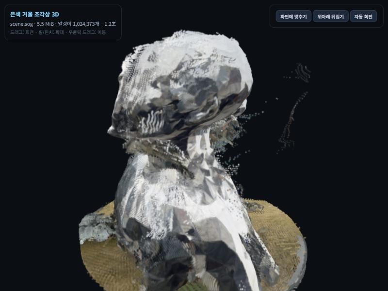

# 은색 거울 조각상 3D 뷰어

가산현대아울렛 앞 공공장소에 있는 은색 거울 조각상을 아이폰 사진 28장으로 복원해 브라우저에서 돌려 볼 수 있게 만든 3D 뷰어입니다.
가우시안 스플랫(3D Gaussian Splatting)을 three.js + Spark 로 그립니다.

## 대상 작품

현대아울렛 가산점 앞 조각상입니다.

| 항목 | 내용 |
|---|---|
| 작품명 | THEY (2013) |
| 작가 | 이진준 (Lee Jin Joon) |
| 제작연도 | 2013년 |
| 크기 | 약 7m |
| 재료 | 스테인리스 스틸, LED 조명 |

서로 다른 방향을 바라보는 두 사람이 포옹하는 모습으로, 차이를 넘어선 이해와 사랑, 조화를 표현한 작품입니다.
(작품 정보는 촬영자가 제공한 내용입니다. 이 저장소의 3D 데이터는 작가·소유자와 무관한 학습용 복원물입니다.)

## 공개 판단

야외 공공장소(현대아울렛 가산점 앞)에 상시 설치된 조형물이라 누구나 볼 수 있는 대상이고, 비영리 학습 과제로 작가·작품명을 밝혀 공유합니다. 촬영 중 지나간 행인은 지우거나 제외했고 사진·원본은 올리지 않았으며 3D 데이터에는 조각상과 바닥 일부만 남겼습니다. (작품의 저작권은 작가에게 있으며, 문제가 있으면 저장소를 내리겠습니다.)

- 뷰어 주소: https://skygaul.github.io/my-open-space-3d/
- 파일: `index.html`(뷰어), `scene.sog`(3D 데이터, 5.5 MiB)
- 화면 캡처: `shots/viewer.png`

## 만든 순서

사진 58장 중 28장 선별(한 바퀴 약 360° 촬영) → MapAnything 복원(점) → 알갱이(PLY) → SOG 로 줄이기 → 웹 뷰어

## 측정값

### 입력
| 항목 | 값 |
|---|---|
| 사진 장수 | 58장 중 28장 선별 (아이폰 DNG → 긴 변 1600px JPG 로 변환) |
| 원본 해상도 | 4073x7240, 4536x8064 두 종류 |
| 모델 입력 크기 | 세로 사진이라 294x518 로 줄어 처리됨 (JPG 900x1600 → 모델 내부에서 한 번 더 축소) |

### 복원 (Google Colab)
| 항목 | 값 |
|---|---|
| GPU | Tesla T4 (15 GB) |
| 모델 | facebook/map-anything-apache (Apache-2.0), fp16 |
| 복원 시간 | 12.4초 (모델 내려받기·불러오기 53초 별도) |
| 최대 GPU 메모리 | 7.28 GB |
| 점 개수 | 2,570,435 → 이상점(각 축 0.5~99.5 백분위 밖) 제거 후 2,512,820 |
| **카메라 퍼짐 비** (카메라 상자 대각선 ÷ 장면 상자 대각선) | **0.709** = 34.20 ÷ 48.24 (장면은 자르기 전, 이상점 제거 후 점 전체 기준. 0.1 이상이라 정상) |

참고: 신뢰도 필터(percentile 30)를 켠 것이 최종이고, 필터를 끈 1차 복원에서는 점 2,880,339개, 퍼짐 비 0.374 였습니다. 카메라 위치는 같고 멀리 튄 점이 달라 장면 상자 크기만 달라진 것입니다.

### 알갱이와 파일 크기
조각상 주변(수평 반경 4.2, 높이는 지면 근처부터 꼭대기까지)만 잘라 **알갱이 1,024,373개**로 만들었습니다.
알갱이 반지름은 `K × (장면의 가장 긴 변) / √N`, K=1.8 입니다. y·z 부호를 뒤집어 three.js 의 Y-위 좌표에 맞췄습니다.

| 형식 | 바이트 | MB (÷1,000,000) | MiB (÷1,048,576) | PLY 대비 | 알갱이당 바이트 |
|---|---|---|---|---|---|
| `.ply` (f_rest 없음) | 69,657,781 | 69.7 | 66.4 | 1.0배 | **68.0** |
| `.splat` | 32,779,936 | 32.8 | 31.3 | 2.1배 | 32.0 |
| `.compressed.ply` | 16,678,773 | 16.7 | 15.9 | 4.2배 | 16.3 |
| `.spz` | 8,979,291 | 9.0 | 8.6 | 7.8배 | 8.8 |
| **`.sog`** (웹에 올린 것) | 5,806,097 | 5.8 | 5.5 | 12.0배 | 5.7 |

변환 도구: splat-transform 3.10.3 (Spark 2.1.0 이 읽는 SOG v2 로 저장).

## 한계

복원되지 않았거나 어긋난 자리를 **시차와 정렬**로 설명합니다. 복원은 같은 점을 여러 사진에서 찾아 맞추고(정렬), 사진마다 그 점이 움직인 정도(시차)로 거리를 잽니다.

- **거울 반사 → 시차가 틀어짐 → 정렬 실패.** 은색 거울 표면에는 보는 각도마다 다른 풍경이 비칩니다. 같은 표면 점인데도 사진마다 모양이 달라 서로 맞추지 못하고, 모델은 그것을 표면이 아니라 거울 속 먼 풍경으로 보고 깊이를 잘못 잽니다. 그래서 조각상 표면이 줄무늬처럼 번지고 일부는 허공에 흩어집니다. 신뢰도 필터를 켜자 흩어진 점이 줄고 얼굴 윤곽이 드러났지만(점 약 13% 감소) 완전히 매끈하지는 않습니다.
- **안 찍힌 면 → 시차 정보 없음 → 검은 자리.** 한 바퀴를 돌며 찍었기 때문에 위쪽이나 사진 두 장 이상에서 겹쳐 보이지 않은 면은 거리를 잴 수 없어 비어 있거나 각도를 크게 틀면 검게 보입니다.
- **해상도.** 원본(4073x7240, 4536x8064)을 긴 변 1600px 로 줄여 쓰고, 모델이 다시 294x518 로 줄여 처리해 가는 부분과 세부가 뭉개집니다. 원본 해상도는 활용하지 못했습니다.
- **배경은 버렸습니다.** 반사로 멀리 튄 점 때문에 장면이 한없이 커져서 조각상 주변만 잘랐고, 주변 건물·바닥은 포함하지 않습니다. 바닥 일부(이끼 낀 받침)만 남았습니다.
- **사람.** 촬영 중 지나간 행인은 사진에서 지우거나 제외했습니다. 지운 자리에 약간의 얼룩이 있습니다. 공개한 3D 데이터에서 확인한 범위에서는 사람이 보이지 않습니다.
- **알갱이 크기는 눈으로 조정.** 크기 K 는 SuperSplat 에서 눈으로 비교해 1.8 로 골랐습니다(1.0 은 구멍이 많음).

## 사용한 것
MapAnything(Apache-2.0), three.js(MIT), Spark(MIT), splat-transform(MIT).
